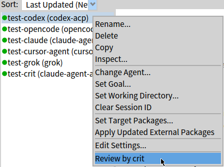
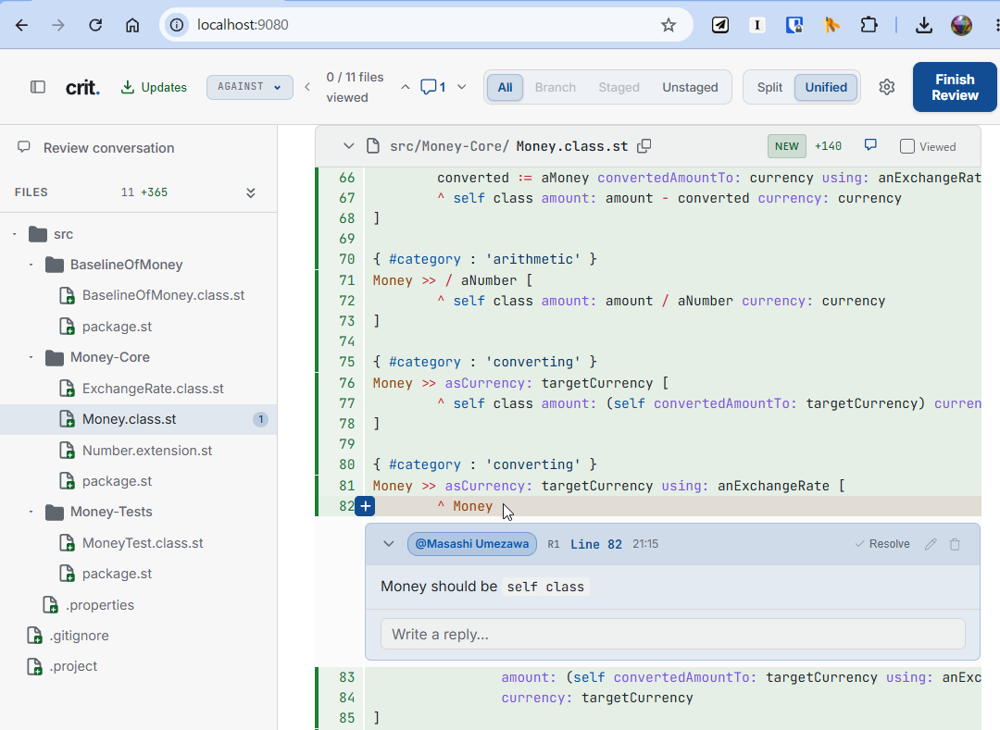
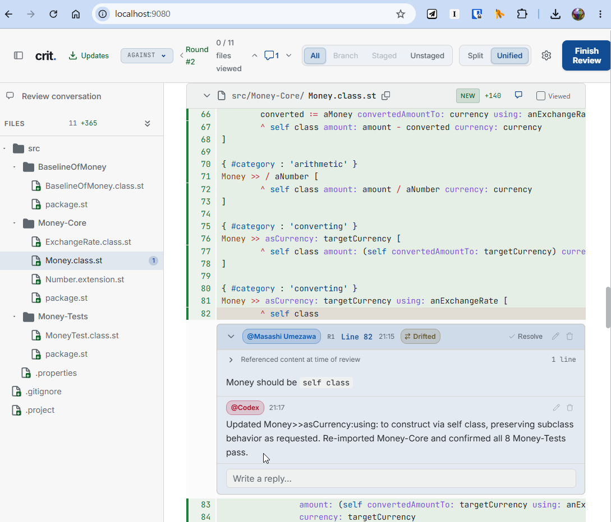
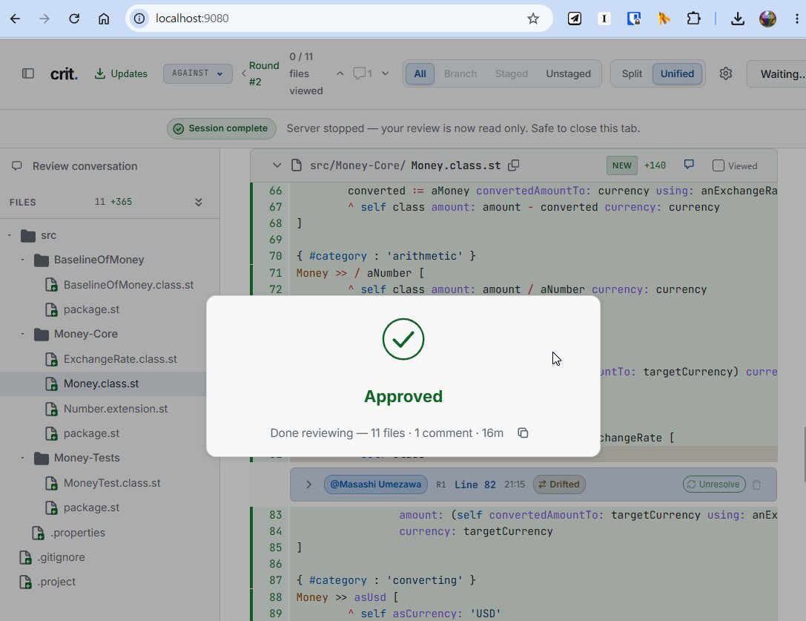
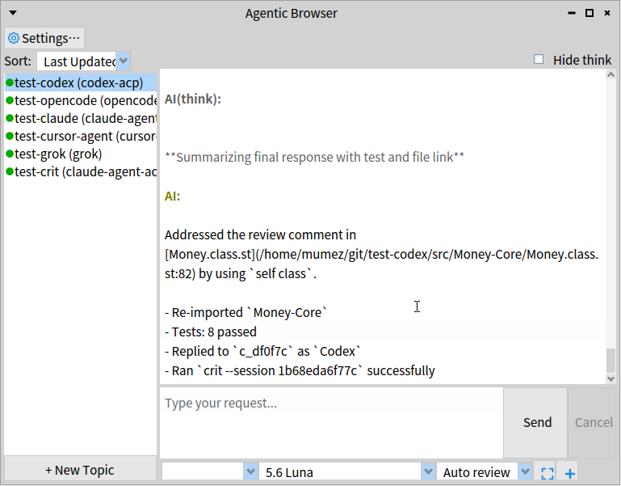

# Code Review with crit

## What is crit?

[crit](https://github.com/tomasz-tomczyk/crit) is a local tool for reviewing the changes made by AI coding agents in a web browser. You comment on specific lines, and the agent receives those comments and can reply to them.

AgenticBrowser starts crit for you from a topic's menu (or a button in the Web UI), and the agent's work on your comments flows into the topic's conversation.

## Installation

Install the `crit` command and make sure it is on your `PATH`. For example:

```bash
# Homebrew
brew install crit

# Go
go install github.com/tomasz-tomczyk/crit/cmd/crit@latest
```

See the [crit repository](https://github.com/tomasz-tomczyk/crit) for other options, including prebuilt binaries.

crit review is disabled by default. To enable it, check **Use crit review** in the Settings dialog (or set `useCrit` to `true` in `ab-settings.json`). See [Settings](../README.md#settings) for the other crit settings.

## Review Flow

### 1. Start the review

The topic's working directory must be a git repository. When the agent's turn has ended, right-click the topic and choose **Review by crit**. The item is disabled while the agent is working.



### 2. Add comments

crit opens in your web browser. Review the changed files and add comments to the relevant lines.



### 3. Send the review to the agent

Press **Finish Review**. AgenticBrowser sends your review to the topic's agent once its turn has ended (it checks every `monitoringIntervalSeconds`).

The first time, crit asks you to trust the project's hooks. AgenticBrowser needs these hooks to receive the review result.

### 4. Check the agent's response

The agent's replies to your comments appear in crit, and the changes are shown as a new review round.



If more changes are needed, add comments and press **Finish Review** again.

### 5. Approve the review

When you are satisfied, approve the review. Once crit shows **Approved**, you can close the browser tab.



### 6. Resume the conversation

The agent's response to the review is also shown in the topic's conversation in AgenticBrowser. You can continue the conversation from there.



## Notes

- AgenticBrowser adds `on_finish_unresolved` / `on_finish_approved` hooks to the working directory's `.crit.config.json`. If the file already defines its own hook for either of them, AgenticBrowser leaves it unchanged and does not deliver the first result.
- AgenticBrowser delivers only the first Finish after a review starts. The hook saves the result under `<imageDir>/agentic-browser/crit-results/`, and the prompt sent to the agent ends with `crit --session <id>`, so the agent receives later rounds from crit itself.
